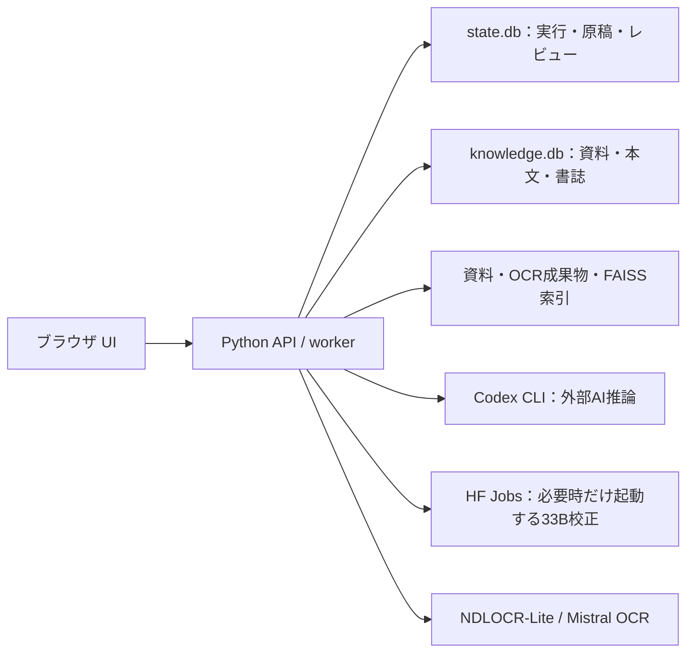

# ふかみる / Fukamiru

研究資料の取り込み、検索、翻訳、原稿生成、人間によるレビューを、ローカルのブラウザで行う研究ワークベンチです。
資料と処理状態は自分の環境で管理し、AI推論や一部のOCRには外部サービスを利用します。
ソースから導入するアプリケーションで、モデルや認証、研究資料は同梱しません。

## できること

- PDF・EPUB・HTML・テキスト等を取り込み、OCR、書誌管理、全文検索・意味検索に利用
- 資料の前後の本文を読み、原文引用と出典を付けた日本語の検索レポートを保存
- メモや資料から論証・出典を検査しながら翻訳・原稿を生成
- LLM-jpによる日本語の局所校正と、内容・引用・表記の検査
- 原稿の差分確認、保護した人間の文章、質問ごとの回答、承認と再生成
- 待ち行列、進捗、途中結果、再開、処理フローの確認
- 共通スタイルのHTMLプレビューとHTML保存。引用・脚注と段落IDを保持

基本導入ではProject管理、テキスト取り込み、全文検索から始められます。
AI・OCR・意味検索は、使いたい機能の依存物と認証を追加して利用します。

## アプリケーションの構成



UIはHTML・CSS・JavaScriptです。FastAPI / UvicornがUIとAPIを配信し、workerが処理を進めます。
通常利用にNode.jsのビルドサーバーは不要です。
SQLiteのテーブルが状態の正本で、SSEは進捗等の通知と再送に使います。
原稿の正本は検証済みHTML、Projectごとの変更履歴はGitで管理します。

`state.db`と`knowledge.db`は別ファイルです。資料・OCR結果・索引・モデル・ログもソースとは分けます。
保存先はGit対象外の`config/local.toml`で指定し、相対パスはリポジトリ直下から解決します。
詳細は[保存先の構成](docs/specification/storage-layout.md)を参照してください。

## 基本導入

Python 3.11以上、Git、Webブラウザを用意します。Windowsではリポジトリ直下で実行します。

```powershell
PowerShell -ExecutionPolicy Bypass -File .\scripts\windows\install.ps1
PowerShell -ExecutionPolicy Bypass -File .\scripts\windows\start.ps1
```

ブラウザで <http://127.0.0.1:8766> を開きます。
初回に`.venv`、`config/local.toml`、空のDBを作ります。既存のローカル設定は上書きしません。
停止は`scripts/windows/stop.ps1`です。

macOS・LinuxではPython CLIで起動できます。外部ツール連携を含む全機能の検証はWindows中心です。
手動導入、停止、追加設定、既存環境の更新は[セットアップ](docs/setup.md)を参照してください。

## 機能ごとの前提

| 機能 | 必要な準備・実行場所 |
| --- | --- |
| Project管理・テキスト取り込み・全文検索・HTML表示 | 基本導入だけで利用。端末上で実行 |
| 翻訳・原稿生成・AI検索レポート | Codex CLIと利用者自身のログイン。対象モデルを利用できるアカウント |
| 現行の日本語33B校正 | `.[hf-jobs]`、HF認証・Jobs権限・正のクレジット残高。H200 JobでLLM-jp-4.1 33B BF16を実行。Codexも使用 |
| 同じ33Bを自前のサーバーで校正 | 適合するllama.cpp、33B BF16モデル、65,536-token contextとhigh推論。モデルを収容できる環境 |
| 旧方式のローカル推敲 | llama.cppの`llama-server`、対応GGUF、各モデルのパス設定。現行33B方式とは別profile |
| 意味検索・RAG | `.[rag]`、準備済みBGE-M3キャッシュ、FAISS、互換PyTorch。端末のGPU設定は校正用HFとは別 |
| 日本語解析 | `.[japanese]`：MeCab・UniDic Lite・GiNZA |
| 日本語OCR | ローカルNDLOCR-Lite。専用インストールスクリプトあり |
| その他の対応言語のOCR | `.[ocr]`と利用者自身の`MISTRAL_API_KEY`。Mistralへ画像を送信 |
| 補助Web検索（任意） | 別プロセスのRustXNG v0.30.0 Standard。[接続方法](docs/specification/research-source-handoff.md) |
| UIの開発・自動検査 | Node.js / npm |

HFで33B校正する場合、その33Bを端末GPUへ載せる必要はありません。
この方式では、端末へのllama.cpp・Docker・33Bモデルの導入も不要です。推論環境はHF側で用意します。
端末でCUDAによるRAGを使う場合のGPU条件は別に残ります。
Windowsの`install.ps1 -Full`はCUDA 12.6用PyTorchとRAG・日本語解析・OCRの依存を追加します。
HFの追加依存・認証・有効化は別途必要です。基本導入では意味検索とHF自動起動は無効です。

Codexのモデルは工程別に固定され、主に`gpt-5.6-sol`、表記整形等に`gpt-6-luna`を使います。
これらを利用できるCLI・アカウントが必要です。任意モデルへの置換を保証する構成ではありません。

## 現行の日本語校正

`llmjp33b_adopt` profileでは、LLM-jp-4.1 33B thinking BF16・highが各節1回で診断・理由・局所修正案を返します。
この方式は原稿生成の日本語校正用です。翻訳のローカル後編集と他のprofileは、それぞれ従来のモデル設定を使います。
本文全体を書き直さず、アプリが原文対応、HTML、引用、書名、段落ID、保護本文を検査します。
Solは内容変更や文の破損を確認し、Lunaは既存の表記規定を適用します。
採用できない案は理由とともに人間確認へ残します。モデルの判断が常に正しいことを保証するものではありません。

HF自動管理は、保存済み結果を先に確認し、未取得の節がある場合だけJobを起動します。
校正区間の完了・失敗・取消で停止を確認し、保存済み応答を再利用します。
応答不明の節は自動再送せず、停止未確認のJobがある間は新規割当を止めます。

共有の既定profileは`local_v32`です。**現行33B方式を使うにはprofileと実行先の明示設定が必要です。**
[導入手順](docs/setup.md#現行33b校正をhf-jobsで使う)、[校正の契約](docs/specification/japanese-proofreading.md)、
[HFの実行・停止・復旧](docs/specification/hf-proofreading-jobs.md)を参照してください。

## データの送信と保存

| 送信先 | 送る情報 |
| --- | --- |
| Codex CLIの外部推論 | 対象文章、原稿の指示・根拠、レビュー対象。機能によりページ画像も使用 |
| HFの校正用Job | 対象節の本文・見出しと前後各最大1段落、修正指示 |
| Mistral OCR | OCR対象の画像・ページ |
| 文献API・Web取得先 | 検索語、書誌の照会、公開本文の取得要求 |

文献探索にはOpenAlex、Crossref、国立国会図書館サーチ、Semantic Scholar、Open Library等を利用します。
外部推論・OCR・GPUには各サービスの認証と利用条件・料金が適用されます。
利用者自身の認証を使い、トークンや認証ファイルをソースへ保存しないでください。

BGE-M3など端末用モデルは実行前にキャッシュへ準備します。
HF校正用workerはJob起動時に固定モデルとランタイムを取得し、revision・容量・SHA-256を検証します。
HFの起動時間やモデル取得時間も費用・時間枠の検討に含めてください。

## 更新・検証

更新時は利用者設定を保持し、既存migrationを変更せず新しいmigrationを追加します。
実行中の処理を終え、二つのDBと必要なファイルを整合した状態でバックアップしてから更新してください。
SQLite・Gitの保存先にはNTFS等の対応ファイルシステムを使い、exFATを使用しないでください。

[検証記録](docs/validation.md)、[レビュー画面](docs/review-workspace.md)、
[検索レポート](docs/specification/knowledge-search-reports.md)も参照できます。
配布ソースとアーカイブには公開検査を行い、テストには独立した架空データを使います。

## License

本ソフトウェアは、GNU General Public License v3.0（GPLv3）に基づいて公開されています。

GPLv3の条件に従う限り、商用・非商用を問わず、自由に利用・改変・再配布できます。ただし、著作権表示およびライセンス情報を保持し、原作者を偽って再配布することは禁止します。

GPLv3の条件によらない商用利用（ソースコードを非公開とする製品への組込みなど）については、別途商用ライセンスを提供しています。
商用ライセンスをご希望の場合は、原作者までお問い合わせください。

Copyright © 2026 [Masanao Sato]

ライセンス本文は[LICENSE](LICENSE)、依存物・モデル・外部ツールの条件は[第三者ソフトウェアの表記](THIRD_PARTY_NOTICES.md)を参照してください。
別途商用ライセンスが適用される場合も、第三者ソフトウェアのライセンス条件は別に適用されます。
