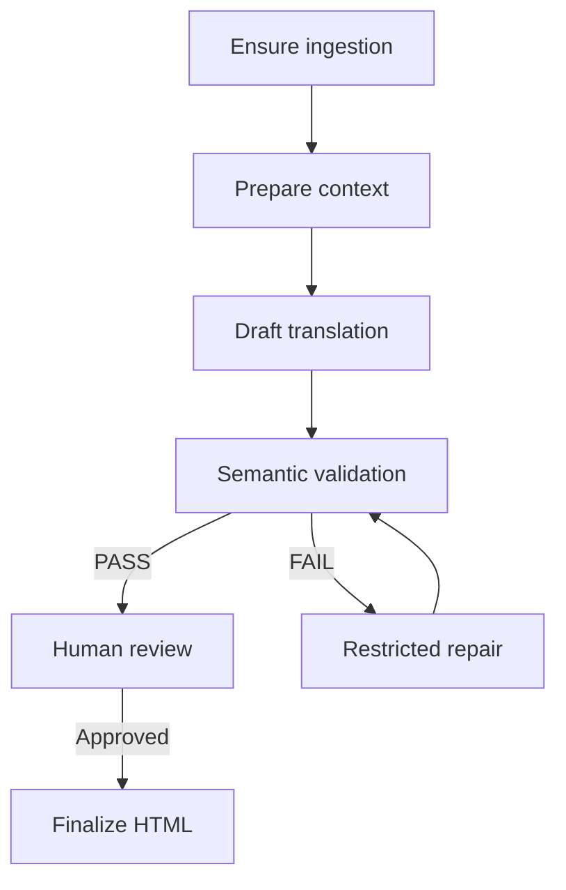

# Workflow Graph v1

Workflow definitions are data, not implicit control flow. Every definition has a stable name, version, entry node, node contracts and condition-labelled edges.

Cycles are allowed because evaluation and repair form an intentional loop. Validation rejects duplicate ids, missing endpoints and unreachable nodes; it does not reject cycles.

## Translation v1

The semantic validator checks meaning, Claim, modality, argument role and Evidence relation. Human edits create a new immutable TranslationVersion and remain eligible for later human correction.

## Execution invariant

No handler may mutate another node's output in place. It must create a new artifact or Revision and return its reference through `NodeOutput`.
